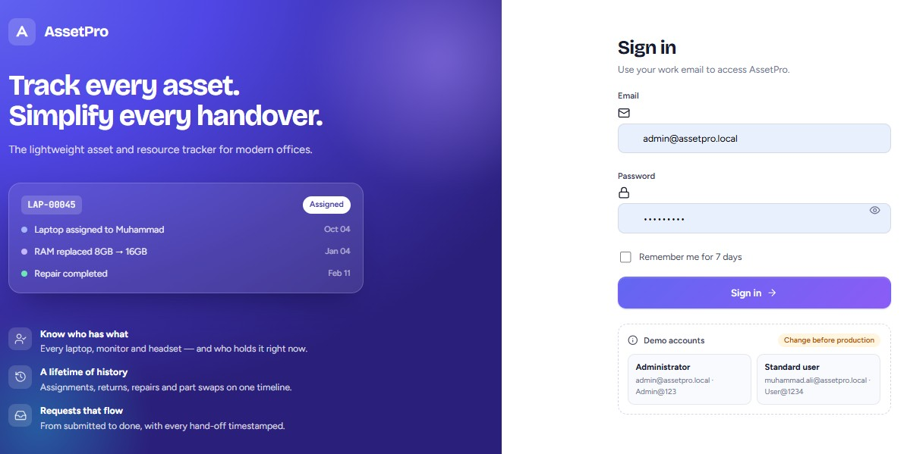
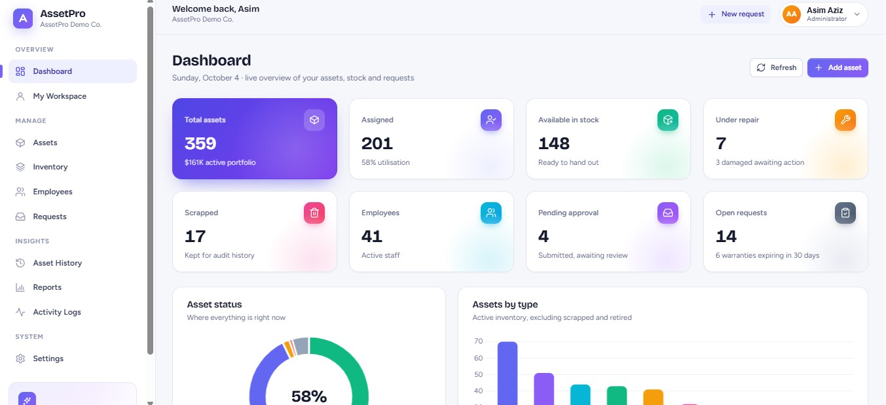
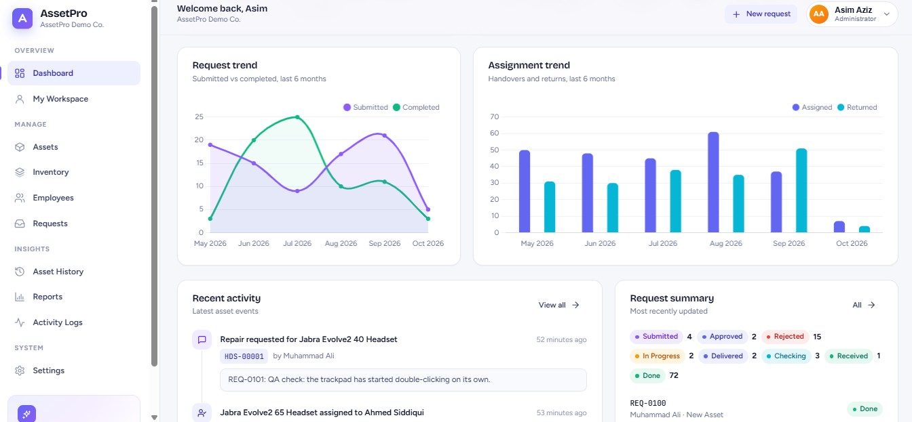
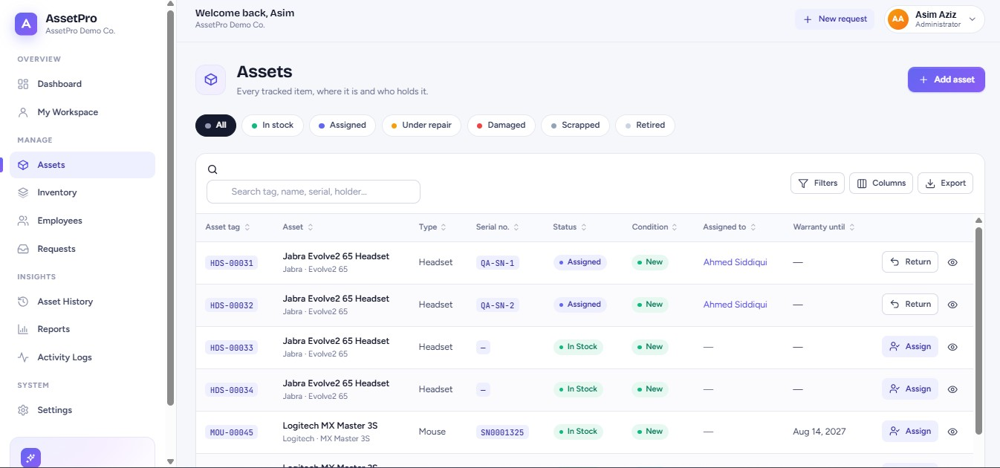
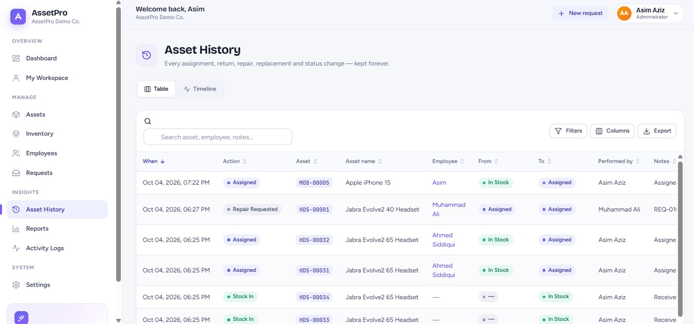
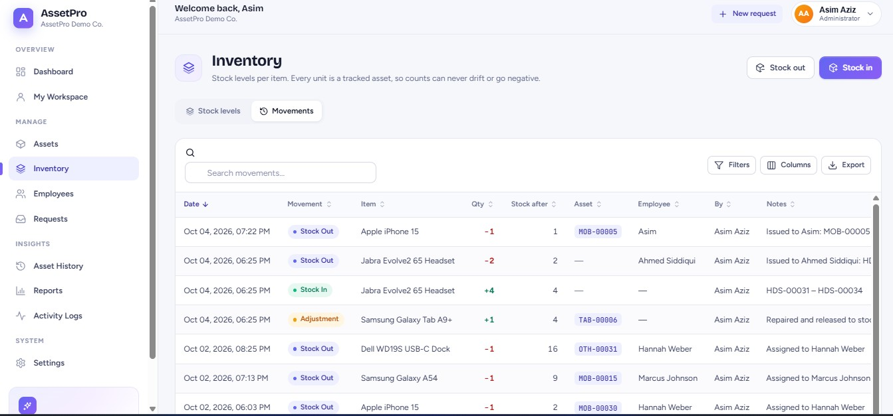
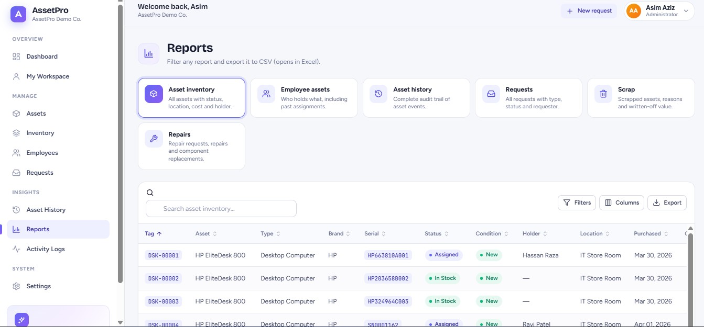

# AssetPro

**Track Every Asset. Simplify Every Handover.**

AssetPro is a small, polished office asset and resource tracker. It shows what the company owns, what is in stock, who holds each item, and everything that happened to an asset during its life: assignments, returns, repairs, component replacements and scrapping. Employees raise requests, and every request moves through a clear, timestamped workflow.

It is an MVP built to production standards: a .NET 10 REST API with SQLite and an Angular single-page app with a modern SaaS interface.

---

## Screenshots

### Sign in



The demo accounts are one click away, so you can get in without reading the README first.

### Dashboard



Eight live metrics, each with the detail that makes it actionable — utilisation next to the assigned count, how many damaged items are awaiting action, how many warranties expire within 30 days.



Six months of request and handover trends, the latest asset events, and a breakdown of every request by status.

### Assets



Filter chips for each status, then search, sort, per-column filters, show/hide columns and CSV export. The row action changes with the asset's state — *Assign* when it is in stock, *Return* when someone holds it.

### Asset history



Every assignment, return, repair, replacement and status change, with the status it moved from and to. Switch to *Timeline* for the same events in narrative form.

### Inventory



Every stock movement with the balance left afterwards, so a count can always be traced back to the events that produced it.

### Reports



Six reports over the same table engine — filter any of them and export the filtered rows to CSV.

---

## Features

| Area | What you get |
| --- | --- |
| **Dashboard** | Live metric cards, asset-status doughnut, assets-by-type bar chart, monthly request and assignment trends, recent activity, request summary, low-stock alerts. All numbers come from the API. |
| **Assets** | Create and edit assets. Assign, return, repair, replace components, mark damaged, retire and scrap them. Each asset has a timeline, a list of past assignments and a component history. |
| **Inventory** | Stock in N units at once (each unit becomes a tracked asset with its own tag), stock out to employees, a movement log, and reorder levels. Quantities can never go negative. |
| **Employees** | Profiles with assigned assets, a full asset timeline and their requests. You can optionally create a sign-in account when adding an employee. |
| **Requests** | Repair, Replacement, New Asset, Return and Other. Workflow: `Submitted → Approved → In Progress → Delivered → Checking → Received → Done` (or `Submitted → Rejected`). |
| **Asset history** | A company-wide audit trail as a filterable table or a timeline. History is never deleted. |
| **Reports** | Asset inventory, employee assets, asset history, requests, scrap and repairs. All are filterable and export to CSV. |
| **Activity logs** | User activity (sign-ins, assignments, approvals and more) plus an application log of warnings and errors, both stored in SQLite. |
| **Settings** | Company preferences, master data (departments, designations, locations, brands, asset types), users and permissions. |
| **Advanced tables** | Server-side search, sorting, paging, per-column filters (text, multi-select, date and number ranges), show/hide columns, clear filters, CSV export, and loading, empty and error states. |
| **Smart dropdowns** | Master-data selects end with **+ Add new…**. The new value is saved, the list refreshes, and the new value is selected for you. |
| **Employee picker** | One searchable dropdown: type to filter, arrow keys to move, Enter or click to choose. Highlighting never selects by itself, so arrowing past a name can't pick it by accident. |
| **Administrator deletes** | Administrators can permanently delete assets, employees, requests, inventory items and sign-ins, with a typed confirmation on every one. Everyone else works through the lifecycle actions, which keep the audit trail. |

### Business rules enforced by the API

- An asset can't be assigned to two people at once. The service checks this, and a unique filtered index in the database also prevents it.
- Scrapped, retired, damaged and under-repair assets can't be assigned.
- Only assigned assets can be returned. An assigned asset must be returned before it is scrapped.
- Stock-out fails without changing anything if there isn't enough stock.
- Every assignment, return, repair, replacement, scrap and status change writes a history row in the same transaction.
- Request statuses can't be skipped. Each step is limited to the right person: approver, processor, closer or the original requester.
- Deletion is administrators-only and is refused where it would leave the data inconsistent: an employee still holding assets, an inventory item that still has assets, your own account, or the last administrator. Deleting an employee also removes their sign-in and their requests.

---

## Tech stack

| Layer | Technology |
| --- | --- |
| API | ASP.NET Core Web API (.NET 10), C# |
| Data | Entity Framework Core 10, SQLite, EF migrations |
| Auth | JWT bearer tokens, permission-based policies, ASP.NET Core `PasswordHasher` (PBKDF2) |
| Frontend | Angular 21 (standalone components, signals, zoneless), TypeScript, Reactive Forms |
| UI | Hand-built design system (CSS custom properties), Chart.js, SweetAlert2 |
| Tests | xUnit + `WebApplicationFactory` integration tests (API), Vitest (Angular) |

---

## Architecture

```text
Angular SPA ──HTTP/JSON──▶ ASP.NET Core API ──EF Core──▶ SQLite (assetpro.db)
   (localhost:4200)          (localhost:5080)
```

- **API**: organised by feature (`Features/Assets`, `Features/Requests`, …). Controllers stay thin. Business rules live in services such as `AssetService` and `RequestService`. A single global middleware turns exceptions into a consistent `{ status, title, message, errors, traceId }` body.
- **Frontend**: `core/` (API client, auth, guards, interceptors), `shared/` (data table, modal, smart select, timeline, stepper, badges, stat cards), `layout/` (sidebar, top bar, footer) and lazy-loaded `features/`.

See [ARCHITECTURE.md](ARCHITECTURE.md) for details.

---

## Getting started

### Prerequisites

- [.NET SDK 10](https://dotnet.microsoft.com/download)
- [Node.js](https://nodejs.org/) 22.12 or newer (the Angular CLI is installed locally by `npm install`)

### 1. Run the API

```bash
cd backend/src/AssetPro.Api
dotnet run --launch-profile http
```

The API listens on **http://localhost:5080**. On first start it:

1. applies the EF Core migrations, which creates `assetpro.db` next to the project
2. seeds the default administrator, then simulates six months of day-to-day operation

The simulation performs about **ten real operations every day for the last 184 days** — stock-ins,
assignments, returns, repairs, component replacements, scrapping and the request workflow — each writing
the same history, inventory and activity rows the API writes at runtime. You end up with roughly
**40 employees, 370 assets, 1,400 asset-history entries, 1,900 activity entries and 100 requests**,
so every screen, chart, filter and report has realistic data from the first page load.
Seeding takes a few seconds; it only runs when the database is empty.

A health check is available at `GET /api/health`.

### 2. Run the frontend

```bash
cd frontend
npm install
npm start
```

Open **http://localhost:4200**. The dev server proxies `/api` to `http://localhost:5080` (see `frontend/proxy.conf.json`), so no CORS setup is needed during development.

### Database setup

There is nothing to install: SQLite is file-based and the schema is created by migrations at startup.

| Task | Command (from `backend/src/AssetPro.Api`) |
| --- | --- |
| Reset to fresh demo data | stop the API, delete `assetpro.db*`, start it again |
| Start with no demo data (admin only) | set `Seed__DemoData=false` before the first start |
| Change how much history is generated | set `Seed__HistoryDays` (default `184`; `0` seeds the fixed demo scenario only) |
| Add a migration after model changes | `dotnet ef migrations add <Name> -o Data/Migrations` |

---

## Default login

> ⚠️ **Development and demo credentials only. Change or remove them before using AssetPro with real data.**

| Role | Email | Password |
| --- | --- | --- |
| Administrator | `admin@assetpro.local` | `Admin@123` |
| Standard user | `muhammad.ali@assetpro.local` | `User@1234` |
| Standard user + approver | `daniel.carter@assetpro.local` | `User@1234` |
| Standard user | `fatima.noor@assetpro.local` | `User@1234` |

Every seeded employee account uses `User@1234`; about a third of the simulated staff can sign in, so you
can view the app as different people. Sign in as an administrator to see the full picture.

The development JWT signing key in `appsettings.Development.json` is also for local use only. In any other environment, provide `Jwt__Key` (32+ characters) through an environment variable or a secret store. The API refuses to start without it.

---

## Demo workflow

1. **Sign in as the administrator.** The dashboard opens with live charts.
2. **Assets → In stock → Assign.** Pick an employee and confirm. You'll see a toast such as *"Dell Latitude 5440 assigned to Muhammad Ali successfully."* and the inventory count drops.
3. Open the asset and choose **Replace component** (e.g. RAM 8GB → 16GB). It appears on the timeline, and the assignment stays unchanged.
4. **Return** the asset as *Damaged*, then **Send to repair → Complete repair**, then **Scrap** it. Every step appears in **Asset History**.
5. **Inventory → Stock in** 10 × "Logitech M185 Mouse". Ten new tagged units are created. **Stock out** 2 to an employee.
6. **Sign in as Muhammad** (standard user). He only sees *My Workspace* and *Requests*. Raise a **Repair** request for one of his assets.
7. **Back as the administrator:** open the request, then **Approve → Start processing → Mark delivered**.
8. **As Muhammad:** **I'm checking it → Confirm received**. **As the administrator:** **Close request**. The stepper shows a timestamp for every stage.
9. Check **Activity Logs** for the audit trail, and **Reports** for CSV exports.

---

## Testing

```bash
# Backend: 70 integration tests (real API + throw-away SQLite DB)
cd backend
dotnet build
dotnet test

# Frontend: unit tests (Vitest) and production build
cd frontend
npm test -- --watch=false
npm run build
```

The tests cover authentication, lockout, token revocation, authorization and IDOR, privilege escalation, the asset lifecycle rules, inventory quantities, the request workflow, validation and edge cases. See [TESTING.md](TESTING.md).

---

## Project structure

```text
AssetPro/
├── backend/
│   ├── AssetPro.slnx
│   ├── src/AssetPro.Api/
│   │   ├── Auth/              # Permissions, JWT, current user
│   │   ├── Common/            # Errors, generic grid query (paging/sort/filter)
│   │   ├── Data/              # DbContext, migrations, demo seeder
│   │   ├── Domain/            # Entities and enums
│   │   ├── Features/          # Assets, Inventory, Employees, Requests, Dashboard, Reports, Users, Lookups, Admin
│   │   ├── Infrastructure/    # Exception middleware, SQLite application logging
│   │   └── Services/          # Activity logger
│   └── tests/AssetPro.Tests/  # xUnit integration tests
├── frontend/
│   └── src/app/
│       ├── core/              # API client, auth, guards, interceptors, models
│       ├── shared/            # Data table, modal, smart select, timeline, icons, UI primitives
│       ├── layout/            # App shell (sidebar, top bar, footer)
│       └── features/          # Lazy-loaded screens
└── images/                  # Screenshots used in this README
```
