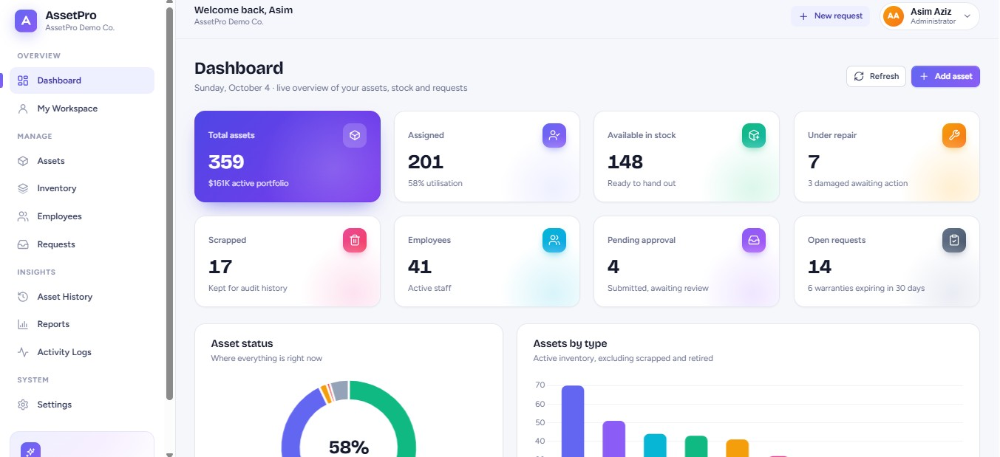
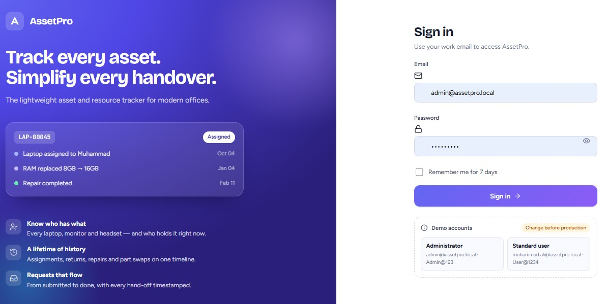
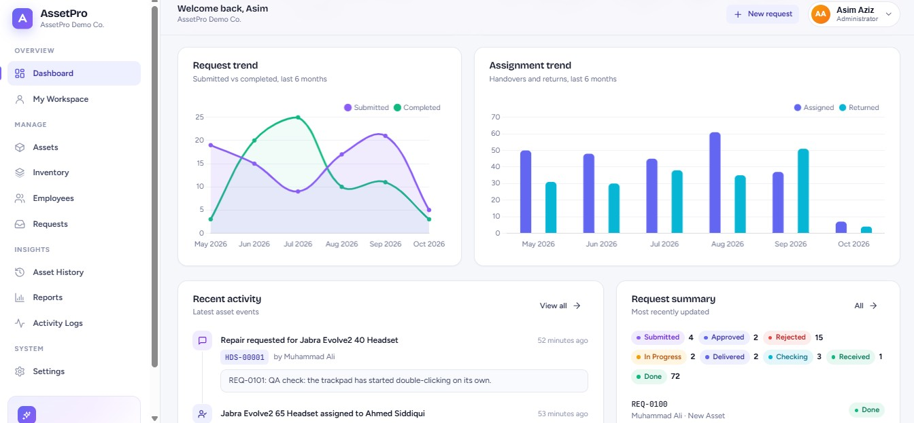
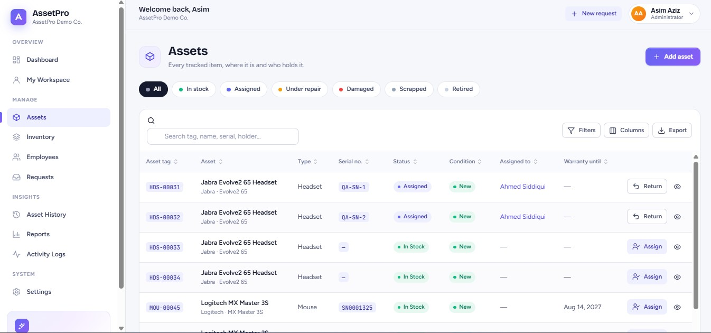
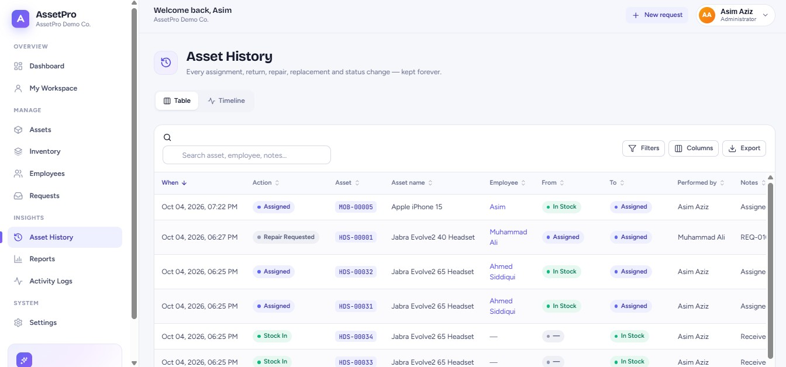
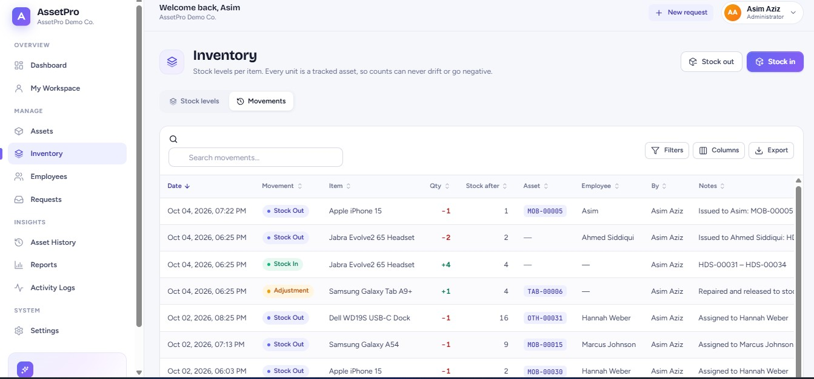
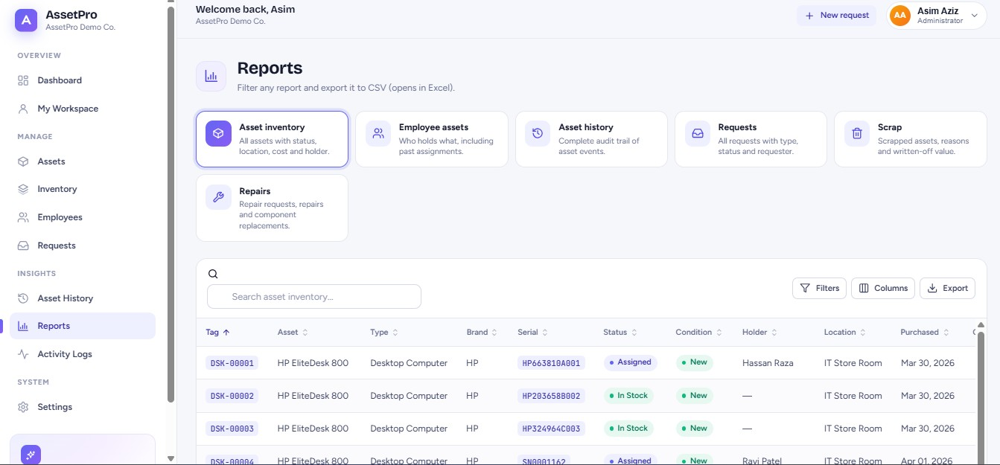
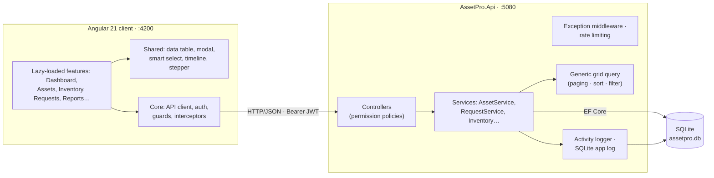
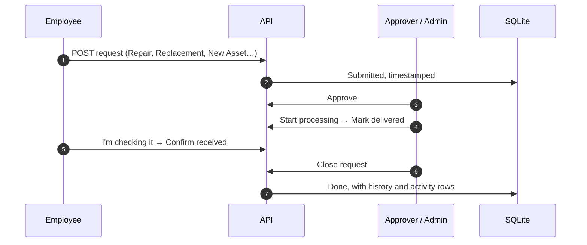

<a id="top"></a>

<h1 align="center">AssetPro</h1>

<p align="center"><b>Track every asset. Simplify every handover.</b></p>

<p align="center">
  
  
  
  
</p>
<p align="center">
  
  
  
  
</p>

<p align="center">
  <a href="#-quick-start"><b>Quick start</b></a> ·
  <a href="#-a-tour-of-the-app"><b>Tour</b></a> ·
  <a href="#-demo-workflow"><b>Demo</b></a> ·
  <a href="#-architecture"><b>Architecture</b></a> ·
  <a href="#-security"><b>Security</b></a> ·
  <a href="#-testing"><b>Testing</b></a>
</p>

<br>

<p align="center">
  
</p>

<br>

**AssetPro** is a small, polished office asset and resource tracker. It shows what the company owns, what is in stock, who holds each item, and everything that happened to an asset during its life: assignments, returns, repairs, component replacements and scrapping. Employees raise requests, and every request moves through a clear, timestamped workflow.

It is an MVP built to production standards: a .NET 10 REST API on SQLite, an Angular 21 single-page app with a modern SaaS interface, business rules enforced on the server, and integration tests against a real database.

<table>
  <tr>
    <td align="center" width="25%"><h2>184</h2><sub>days of simulated operation<br>seeded on first start</sub></td>
    <td align="center" width="25%"><h2>370</h2><sub>tracked assets across<br>~40 employees</sub></td>
    <td align="center" width="25%"><h2>1,400</h2><sub>asset-history entries,<br>never deleted</sub></td>
    <td align="center" width="25%"><h2>7</h2><sub>request stages, each<br>timestamped and role-gated</sub></td>
  </tr>
</table>

<br>

## ✦ Highlights

<table>
  <tr>
    <td width="33%" valign="top">
      <h3>💻 Every asset, every state</h3>
      Create, assign, return, repair, replace components, mark damaged, retire and scrap. The row action follows the asset's state: <i>Assign</i> when in stock, <i>Return</i> when someone holds it.
    </td>
    <td width="33%" valign="top">
      <h3>📜 A history that never forgets</h3>
      Every assignment, return, repair, replacement and status change writes a history row in the same transaction, with the status it moved from and to. View it as a table or a timeline.
    </td>
    <td width="33%" valign="top">
      <h3>📦 Stock that stays honest</h3>
      Stock in N units at once and each becomes a tracked asset with its own tag. Stock out to employees, reorder levels and a movement log with the running balance. Quantities never go negative.
    </td>
  </tr>
  <tr>
    <td width="33%" valign="top">
      <h3>🔁 Requests with a clear path</h3>
      Repair, Replacement, New Asset, Return and Other. <code>Submitted → Approved → In Progress → Delivered → Checking → Received → Done</code>, and no step can be skipped.
    </td>
    <td width="33%" valign="top">
      <h3>🛡️ Rules on the server</h3>
      JWT with permission policies, PBKDF2 hashing, sign-in lockout and rate limiting, and a unique filtered index so an asset can never be held by two people at once.
    </td>
    <td width="33%" valign="top">
      <h3>📊 Tables that do the work</h3>
      Server-side search, sort, paging and per-column filters (text, multi-select, date and number ranges), column chooser and CSV export of exactly what you filtered.
    </td>
  </tr>
</table>

<br>

## ✦ Quick start

> [!NOTE]
> **You need** the [.NET SDK 10](https://dotnet.microsoft.com/download) and [Node.js](https://nodejs.org/) 22.12+. There is no database to install: SQLite is file-based and the schema is created by migrations at startup.

**1. Start the API** on <http://localhost:5080>. The health check is at `GET /api/health`.

```bash
cd backend/src/AssetPro.Api
```

```bash
dotnet run --launch-profile http
```

On first start it applies the EF Core migrations (creating `assetpro.db` next to the project), seeds the default administrator, then simulates **about ten real operations a day for the last 184 days**: stock-ins, assignments, returns, repairs, component replacements, scrapping and the request workflow. Each writes the same history, inventory and activity rows the API writes at runtime, so every screen, chart, filter and report has realistic data from the first page load. Seeding takes a few seconds and only runs when the database is empty.

**2. Start the client** in a second terminal, then open <http://localhost:4200>. The dev server proxies `/api` to the API (see `frontend/proxy.conf.json`), so no CORS setup is needed.

```bash
cd frontend
```

```bash
npm install
```

```bash
npm start
```

**3. Sign in.** The demo accounts are one click away on the sign-in page.

> [!WARNING]
> Development and demo credentials only. Change or remove them before using AssetPro with real data.

| Email | Password | Role |
|---|---|---|
| `admin@assetpro.local` | `Admin@123` | Administrator: sees and manages everything |
| `daniel.carter@assetpro.local` | `User@1234` | Standard user + approver |
| `muhammad.ali@assetpro.local` | `User@1234` | Standard user: *My Workspace* and *Requests* |
| `fatima.noor@assetpro.local` | `User@1234` | Standard user |

Every seeded employee account uses `User@1234`. About a third of the simulated staff can sign in, so you can view the app as different people.

<details>
<summary><b>Configuration, secrets and database tasks</b></summary>

<br>

The JWT signing key in `appsettings.Development.json` is for local use only. In any other environment, provide `Jwt__Key` (32+ characters) through an environment variable or a secret store. **The API refuses to start without it.**

| Task | Command (from `backend/src/AssetPro.Api`) |
|---|---|
| Reset to fresh demo data | Stop the API, delete `assetpro.db*`, start it again |
| Start with no demo data (admin only) | Set `Seed__DemoData=false` before the first start |
| Change how much history is generated | Set `Seed__HistoryDays` (default `184`; `0` seeds the fixed demo scenario only) |
| Change the sign-in rate limit | Set `RateLimit__LoginPerMinute` (default `10`) |
| Add a migration after model changes | `dotnet ef migrations add <Name> -o Data/Migrations` |

</details>

<p align="right"><a href="#top">↑ back to top</a></p>

## ✦ A tour of the app

<table>
  <tr>
    <td width="42%" valign="top">
      <h3>Sign in</h3>
      <p>Product pitch on the left, sign-in form on the right.</p>
      <ul>
        <li>Demo accounts are one click away, so you can get in without reading this file first</li>
        <li>The same message for an unknown email and a wrong password</li>
      </ul>
    </td>
    <td width="58%"></td>
  </tr>
  <tr>
    <td width="58%"></td>
    <td width="42%" valign="top">
      <h3>Dashboard</h3>
      <p>Eight live metrics, each with the detail that makes it actionable.</p>
      <ul>
        <li>Utilisation next to the assigned count</li>
        <li>How many damaged items are awaiting action</li>
        <li>How many warranties expire within 30 days</li>
        <li>Every number comes from the API</li>
      </ul>
    </td>
  </tr>
  <tr>
    <td width="42%" valign="top">
      <h3>Trends and activity</h3>
      <p>Six months of request and handover trends, the latest asset events, and every request broken down by status.</p>
      <ul>
        <li>Asset-status doughnut and assets-by-type bar chart</li>
        <li>Low-stock alerts</li>
      </ul>
    </td>
    <td width="58%"></td>
  </tr>
  <tr>
    <td width="58%"></td>
    <td width="42%" valign="top">
      <h3>Assets</h3>
      <p>Filter chips for each status, then search, sort, per-column filters, show/hide columns and CSV export.</p>
      <ul>
        <li>The row action changes with the asset's state</li>
        <li>Each asset has a timeline, past assignments and a component history</li>
        <li>Master-data dropdowns end with <b>+ Add new…</b>, which saves and selects the new value</li>
      </ul>
    </td>
  </tr>
  <tr>
    <td width="42%" valign="top">
      <h3>Asset history</h3>
      <p>A company-wide audit trail of every assignment, return, repair, replacement and status change.</p>
      <ul>
        <li>Shows who performed each event and the status it moved from and to</li>
        <li>Switch to <i>Timeline</i> for the same events in narrative form</li>
      </ul>
    </td>
    <td width="58%"></td>
  </tr>
  <tr>
    <td width="58%"></td>
    <td width="42%" valign="top">
      <h3>Inventory</h3>
      <p>Every stock movement with the balance left afterwards, so a count can always be traced back to the events that produced it.</p>
      <ul>
        <li>Stock in, stock out and adjustments</li>
        <li>Stock-out fails without changing anything if there isn't enough</li>
      </ul>
    </td>
  </tr>
  <tr>
    <td width="42%" valign="top">
      <h3>Reports</h3>
      <p>Six reports over the same table engine: asset inventory, employee assets, asset history, requests, scrap and repairs.</p>
      <p>Filter any of them and export the filtered rows to CSV.</p>
    </td>
    <td width="58%"></td>
  </tr>
</table>

<details>
<summary><b>Everything else in the box</b> (click to expand)</summary>

<br>

| Area | What you get |
|---|---|
| **Employees** | Profiles with assigned assets, a full asset timeline and their requests. Optionally create a sign-in account when adding an employee. |
| **Activity logs** | User activity (sign-ins, assignments, approvals and more) plus an application log of warnings and errors, both stored in SQLite. |
| **Settings** | Company preferences, master data (departments, designations, locations, brands, asset types), users and permissions. |
| **Employee picker** | One searchable dropdown: type to filter, arrow keys to move, Enter or click to choose. Highlighting never selects by itself, so arrowing past a name can't pick it by accident. |
| **Administrator deletes** | Administrators can permanently delete assets, employees, requests, inventory items and sign-ins, with a typed confirmation on every one. Everyone else works through the lifecycle actions, which keep the audit trail. |

</details>

<p align="right"><a href="#top">↑ back to top</a></p>

## ✦ Demo workflow

1. **Sign in as the administrator.** The dashboard opens with live charts.
2. **Assets → In stock → Assign.** Pick an employee and confirm. A toast such as *"Dell Latitude 5440 assigned to Muhammad Ali successfully."* appears and the inventory count drops.
3. Open the asset and choose **Replace component** (e.g. RAM 8GB → 16GB). It appears on the timeline, and the assignment stays unchanged.
4. **Return** the asset as *Damaged*, then **Send to repair → Complete repair**, then **Scrap** it. Every step appears in **Asset History**.
5. **Inventory → Stock in** 10 × "Logitech M185 Mouse". Ten new tagged units are created. **Stock out** 2 to an employee.
6. **Sign in as Muhammad** (standard user). Only *My Workspace* and *Requests* are visible. Raise a **Repair** request for one of the assigned assets.
7. **Back as the administrator:** open the request, then **Approve → Start processing → Mark delivered**.
8. **As Muhammad:** **I'm checking it → Confirm received**. **As the administrator:** **Close request**. The stepper shows a timestamp for every stage.
9. Check **Activity Logs** for the audit trail, and **Reports** for CSV exports.

<p align="right"><a href="#top">↑ back to top</a></p>

## ✦ Tech stack

<table>
  <tr>
    <th align="left" width="50%">Backend</th>
    <th align="left" width="50%">Frontend</th>
  </tr>
  <tr>
    <td valign="top">
      <b>.NET 10</b> and ASP.NET Core Web API, C#<br>
      <b>EF Core 10</b> on SQLite, with migrations<br>
      <b>JWT bearer</b> tokens and permission-based policies<br>
      <b>PasswordHasher</b> (PBKDF2) from ASP.NET Core<br>
      Built-in <b>rate limiting</b> on sign-in<br>
      Feature folders, thin controllers, plain services<br>
      <sub>No MediatR and no AutoMapper.</sub>
    </td>
    <td valign="top">
      <b>Angular 21</b>: standalone components, signals, zoneless<br>
      <b>Reactive Forms</b> and TypeScript<br>
      Hand-built design system on CSS custom properties<br>
      <b>Chart.js</b> for dashboards<br>
      <b>SweetAlert2</b> for confirmations<br>
      Lazy-loaded feature routes
    </td>
  </tr>
  <tr>
    <th align="left">Quality</th>
    <th align="left">Tooling</th>
  </tr>
  <tr>
    <td valign="top">
      <b>xUnit</b> integration tests with <b>WebApplicationFactory</b> on a throwaway SQLite database<br>
      <b>Vitest</b> unit tests for the client
    </td>
    <td valign="top">
      Angular CLI, installed locally by <code>npm install</code><br>
      Dev-server proxy for <code>/api</code><br>
      Six-month history simulator for demo data
    </td>
  </tr>
</table>

## ✦ Architecture



- **API**: organised by feature (`Features/Assets`, `Features/Requests`, …). Controllers stay thin and business rules live in services such as `AssetService` and `RequestService`.
- **Errors**: one global middleware turns every exception into a consistent `{ status, title, message, errors, traceId }` body, including a 409 when a record was changed by someone else.
- **Frontend**: `core/` (API client, auth, guards, interceptors), `shared/` (UI primitives), `layout/` (sidebar, top bar, footer) and lazy-loaded `features/`.

### The life of a request



### Business rules enforced by the API

| Rule | Behaviour |
|---|---|
| One holder | An asset can't be assigned to two people at once. The service checks it, and a unique filtered index in the database also prevents it. |
| Assignable states | Scrapped, retired, damaged and under-repair assets can't be assigned. |
| Returns and scrap | Only assigned assets can be returned. An assigned asset must be returned before it is scrapped. |
| Stock | Stock-out fails without changing anything if there isn't enough stock. |
| History | Every assignment, return, repair, replacement, scrap and status change writes a history row in the same transaction. |
| Workflow | Request statuses can't be skipped. Each step is limited to the right person: approver, processor, closer or the original requester. |
| Deletes | Administrators only, and refused where it would leave the data inconsistent: an employee still holding assets, an inventory item that still has assets, your own account, or the last administrator. |

<p align="right"><a href="#top">↑ back to top</a></p>

## ✦ Security

<details>
<summary><b>Authentication and sessions</b></summary>

- PBKDF2 password hashing with the ASP.NET Core `PasswordHasher`, rehashed automatically when the algorithm is upgraded.
- The same error for an unknown email and a wrong password, so accounts can't be enumerated.
- Five failed sign-ins lock the account for 5 minutes. Sign-in is rate limited (10 per minute by default).
- JWTs carry a security stamp. Changing or resetting a password, or updating a user's account or permissions, rotates the stamp, so existing tokens stop working.
- The API refuses to start outside Development without a `Jwt__Key` of 32+ characters.

</details>

<details>
<summary><b>Authorization and data</b></summary>

- Every endpoint is guarded by a permission policy on the server. Hiding UI is cosmetic only.
- Standard users only reach their own workspace and requests; IDOR and privilege-escalation attempts are covered by tests.
- Grid filters and sorting run on the server against a fixed set of fields.
- Failed sign-ins, assignments, approvals and deletes are written to the activity log.
- Consistent error bodies with a trace id and no stack traces.

</details>

## ✦ Testing

The backend tests run the real API through `WebApplicationFactory` against a throwaway SQLite database, so every assertion goes through routing, auth, validation and EF Core.

| Area | Covered |
|---|---|
| Authentication | Sign-in, lockout, token revocation |
| Authorization | Permission policies, IDOR, privilege escalation |
| Asset lifecycle | Assign, return, repair, replace, scrap and the rules between them |
| Inventory | Stock in and out, quantities that never go negative |
| Requests | Every workflow step and who may take it |
| Records | Employees, master data and administrator deletes |

```bash
cd backend
```

```bash
dotnet test
```

```bash
cd frontend
```

```bash
npm test -- --watch=false
```

```bash
npm run build
```

## ✦ Project layout

```
backend/
  AssetPro.slnx
  src/AssetPro.Api/
    Auth/                 permissions, JWT, current user
    Common/               errors, generic grid query (paging, sort, filter)
    Data/                 DbContext, migrations, demo seeder, history simulator
    Domain/               entities and enums
    Features/             Assets, Inventory, Employees, Requests, Dashboard, Reports, Users, Lookups, Admin
    Infrastructure/       exception middleware, SQLite application logging
    Services/             activity logger
  tests/AssetPro.Tests/   xUnit integration tests
frontend/
  src/app/
    core/                 API client, auth, guards, interceptors, models
    shared/               data table, modal, smart select, timeline, icons, UI primitives
    layout/               app shell (sidebar, top bar, footer)
    features/             lazy-loaded screens
images/                   screenshots used in this README
```

<br>

<div align="center">

**AssetPro** · crafted in Karachi

© 2026 [masimaziz.com](https://masimaziz.com/) · [asimhashmi47@gmail.com](mailto:asimhashmi47@gmail.com)

<a href="#top">↑ back to top</a>

</div>
